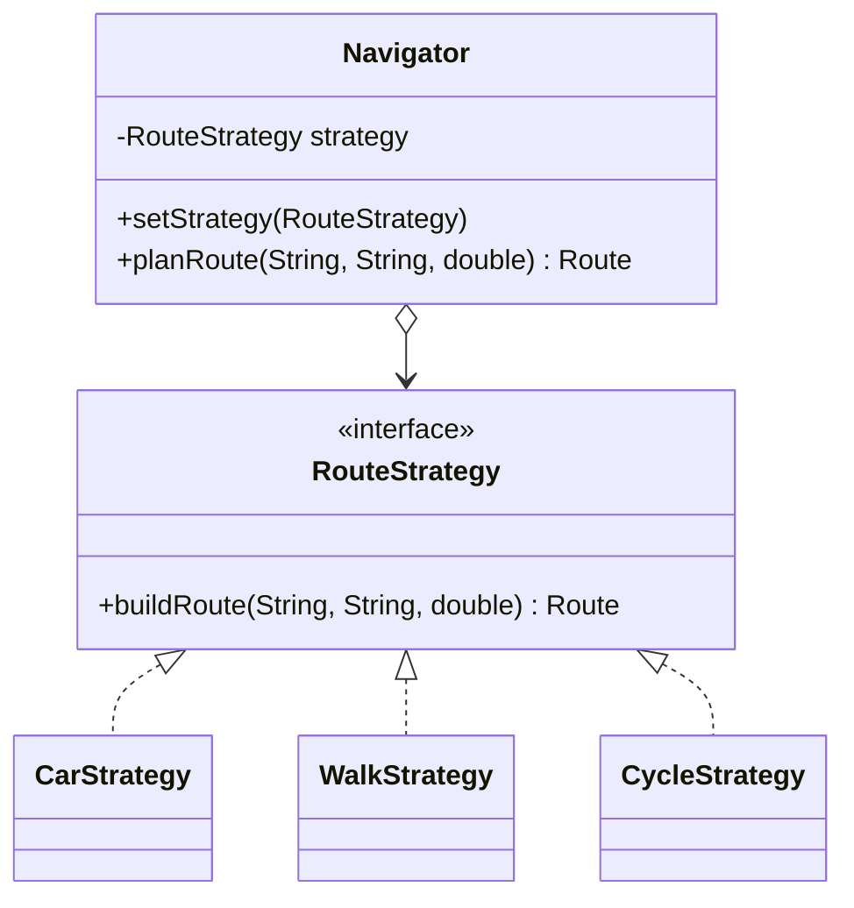

# Strategy Pattern: Navigation / Route Planning

**Course:** ShP-2216 Software Design Patterns, Astana IT University
**Assignment:** #5 Strategy Pattern (Option A: Navigation / Route Planning)
**Author:** Arailym Amangeldi, SE-2528
**Language:** Java 17

## Description

This project implements the **Strategy** behavioral design pattern. A `Navigator`
(Context) plans a route between two points. *How* the route is calculated is
delegated to an interchangeable `RouteStrategy`, so the transport mode can be
changed at runtime without any `if` / `switch` in the Context.

| Role               | Class                                              |
|--------------------|----------------------------------------------------|
| Strategy interface | `RouteStrategy`                                    |
| Concrete strategies| `CarStrategy`, `WalkStrategy`, `CycleStrategy`     |
| Context            | `Navigator`                                        |
| Client             | `Main`                                             |
| Result object      | `Route` (immutable record)                         |

## Project structure

```
.
├── README.md
├── report.md
└── src
    └── navigation
        ├── Main.java
        ├── Navigator.java
        ├── Route.java
        ├── RouteStrategy.java
        ├── CarStrategy.java
        ├── WalkStrategy.java
        └── CycleStrategy.java
```

## Class diagram



## Requirements

- JDK 17 or newer
- IntelliJ IDEA (recommended) or any terminal with `javac` and `java` on the PATH

## How to build and run

### Option 1: IntelliJ IDEA
1. Open the project folder in IntelliJ IDEA.
2. Make sure `src` is marked as **Sources Root** and the Project SDK is 17
   (File -> Project Structure -> Project).
3. Open `src/navigation/Main.java` and click the green **Run** arrow.

### Option 2: Terminal
From the project root:

```bash
javac -d out src/navigation/*.java
java -cp out navigation.Main
```

On Windows PowerShell use backslashes in the first command:
`javac -d out src\navigation\*.java`

## Example output

```
[Car] Astana IT University -> Khan Shatyr | 7.2 km | 9 min
[Walk] Astana IT University -> Khan Shatyr | 6.0 km | 72 min
[Cycle] Astana IT University -> Khan Shatyr | 6.3 km | 25 min
[Scooter] Astana IT University -> Khan Shatyr | 6.0 km | 18 min
```

The last line is produced by a strategy written as a lambda directly in `Main`,
which shows that new behavior can be plugged in without touching existing classes.

## How to use

```text
Navigator navigator = new Navigator(new CarStrategy());
System.out.println(navigator.planRoute("A", "B", 6.0));

navigator.setStrategy(new WalkStrategy());   // switch at runtime
System.out.println(navigator.planRoute("A", "B", 6.0));
```

## How to add a new strategy

1. Create a new class in `src/navigation` that implements `RouteStrategy`:

```text
package navigation;

public class BusStrategy implements RouteStrategy {

    private static final double AVERAGE_SPEED_KMH = 25.0;
    private static final int WAITING_TIME_MINUTES = 7;

    @Override
    public Route buildRoute(String from, String to, double distanceKm) {
        int minutes = (int) Math.round(distanceKm / AVERAGE_SPEED_KMH * 60)
                + WAITING_TIME_MINUTES;
        return new Route("Bus", from, to, distanceKm, minutes);
    }
}
```

2. Use it in the client:

```text
navigator.setStrategy(new BusStrategy());
```

No existing class (`Navigator`, `RouteStrategy`, other strategies) has to be modified.
This is the Open/Closed Principle in practice.

## Clean Code principles applied

1. **Polymorphism instead of conditionals:** `Navigator` has no `if` / `switch` on the transport type.
2. **Intention-revealing names:** `CarStrategy`, `buildRoute`, `planRoute` describe what they do.
3. **Single Responsibility:** each strategy contains exactly one algorithm.
4. **Algorithm-agnostic Context:** `Navigator` depends only on the `RouteStrategy` interface.
5. **No magic numbers:** speeds and factors are named constants.
6. **Open/Closed:** new strategies are added without changing existing code.

Detailed before/after excerpts are in `report.md`.

## Strategy vs. State

In Strategy the **client** chooses the algorithm from outside and strategies do not
know about each other. In State the object changes its own behavior as its internal
state changes, and states usually trigger transitions between themselves. Route
planning has no lifecycle, so Strategy is the right fit.

## Repository

Commit history is incremental: interface and `Route`, concrete strategies,
`Navigator`, `Main`, README, report.