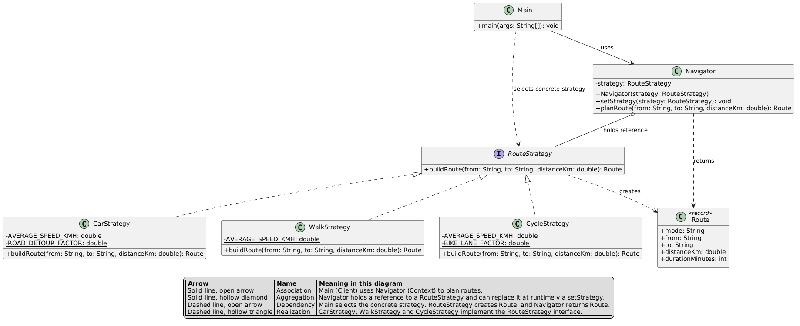

# Assignment #5: Strategy Pattern

**Course:** ShP-2216 Software Design Patterns

**Student:** Arailym Amangeldi, SE-2528

## 1. Introduction
Domain: navigation / route planning. The algorithm family is "how to build a route
between two points", with variants for car, walking and cycling. Each variant
computes distance and duration differently, and the client picks one at runtime.

## 2. UML Class Diagram


## 3. Clean Code Principles

### 3.1 Polymorphism instead of conditionals
Before:
```text
if (mode.equals("car")) { ... } else if (mode.equals("walk")) { ... } else if (mode.equals("cycle")) { ... }
```
After:
```text
public Route planRoute(String from, String to, double distanceKm) {
    return strategy.buildRoute(from, to, distanceKm);
}
```
Justification: no branching on type remains, so adding a mode never changes `Navigator`.

### 3.2 Intention-revealing names
```text
public class CycleStrategy implements RouteStrategy { ... }
navigator.setStrategy(new WalkStrategy());
```
Justification: class and method names say what they do (`buildRoute`, `CarStrategy`), so the code reads without comments.

### 3.3 Single Responsibility
```text
public class WalkStrategy implements RouteStrategy {
    private static final double AVERAGE_SPEED_KMH = 5.0;
    public Route buildRoute(String from, String to, double distanceKm) { ... }
}
```
Justification: each strategy contains exactly one algorithm and the data that algorithm needs.

### 3.4 Context is algorithm-agnostic
```text
private RouteStrategy strategy;  
```
Justification: `Navigator` never references a concrete class, which follows Dependency Inversion and keeps it reusable.

### 3.5 No magic numbers
```text
private static final double AVERAGE_SPEED_KMH = 50.0;
private static final double ROAD_DETOUR_FACTOR = 1.2;
```
Justification: named constants explain the meaning of each value and give one place to change it.

### 3.6 Easy extensibility (Open/Closed)
```text
navigator.setStrategy(new BusStrategy()); 
```
Justification: the system is open for extension and closed for modification.

## 4. Strategy vs. State
Route planning calls for Strategy because the algorithm is chosen by the client from
outside, the strategies do not know about each other, and switching is not driven by
internal events. In State, the context's own state changes as a result of its operations
and the states typically trigger transitions between themselves. A navigator has no
lifecycle: choosing "walk" does not cause it to become "cycle". The strategies are
simply interchangeable ways to do the same job.

## 5. Conclusion
The pattern added one interface and three small classes, but removed all branching from
the context and made new transport modes a one-class change. The cost is more files; the
gain is flexibility, easier testing of each algorithm, and runtime switching.

## 6. GitHub Repository
https://github.com/araildiil/asiksdp5.git